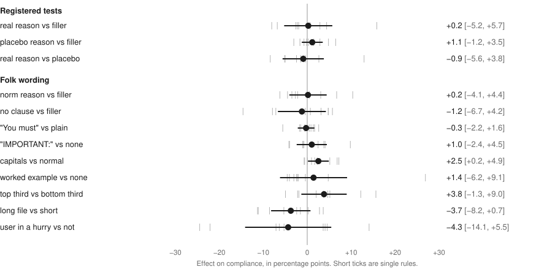

# because

If you write `CLAUDE.md` files or skills for Claude Code, this repo tells you which edits change what the agent does. It holds four preregistered randomized experiments, with the data, the checkers and the harness to rerun them.

Giving a reason for a rule came back inconclusive. No wording factor survives correction on average, though single rules do move in a post hoc look. For skills, the listing budget controls whether a description reaches the model. A long description on a never-used skill that sorts after the budget is spent does not arrive, and a preregistered test that raised the budget, which also showed every other skill's description, took that skill from a load rate of 0.292 to 0.990, +69.8 points [+53.7, +85.8].

![Line chart of skill load rate at 300 skills with late names. At the CLI's own budget, the minimal description loads at 53% [38, 68] and the long trigger list at 29% [12, 46]. With the budget raised to 100,000 characters, minimal loads at 82% [67, 98] and the trigger list at 99% [97, 100].](docs/figures/study2c-budget.svg)

Points are percentage points, of compliance in Study 1 and of skill loading in Studies 2, 2b and 2c. Brackets are 95% intervals. Every result on this page is in [`results/NUMBERS.md`](results/NUMBERS.md), except the listing, audit, pool and review figures, which link to their own reports. Anything exploratory or post hoc says so where it appears.

The [explorer](https://abhaymettu.github.io/because-study/) shows the rules, arms and transcripts behind the numbers, and the [paper](paper/because.pdf) has the full methods.

## What the studies found

### Reasons came back inconclusive

A reason written for the rule, the "real" arm, is +0.2 points [-5.2, +5.7] against a filler sentence of matched length. A content-free placebo is +1.1 [-1.2, +3.5]. The registered bar for calling this a null was both upper bounds under 5 points. The real arm reached 5.7, so this result is not a null, and the code that applies the decision table prints `inconclusive`.

Averaged across these nine rules, the 95% interval against filler stops at +5.7. Single rules are less certain. One, `final_no_first_person`, reads +15.8 (post hoc, Holm p 0.312 across 72 cells). The prediction interval for a new rule is about plus or minus 12, at [-11.6, +11.9] (post hoc). Against no clause the upper bound is +6.8, and leaving one rule out and refitting moves that bound from +3.3 to +8.6 (post hoc). Simulated power at 5 points is 0.56 with a slope SD of 3 points across rules and 0.34 with 6, so a smaller effect could easily go unseen.

Real minus placebo is -0.9 [-5.6, +3.8]. It passes a registered equivalence check at 5 points, TOST p 0.040, and the pass is narrow. It fails at a margin of 4.5 (p 0.058, post hoc). The same test passed in 20% of the pre-freeze simulations with a true gap of 5, because ceilings shrink the gap it sees ([Review 2](docs/REVIEW-2-prereg.md)). Read it as a sensitivity check and nothing stronger.

The design scores literal compliance only. Anthropic's [prompting guide](https://platform.claude.com/docs/en/build-with-claude/prompt-engineering/claude-prompting-best-practices) advises explaining why and says "Claude can generalize from the explanation." That claim is about behavior past the literal rule, so this design does not test it. The nearest case here is the reason written for `final_no_digits`, a voice assistant that stumbles over numerals, which is close to the guide's text-to-speech example. On literal compliance it reads +2.9 (post hoc, `results/study1.json`).

The placebo arm is an analogue of Langer, Blank and Chanowitz (1978), the copier study, in which a placebic "because" worked for a small favor. That paradigm is contested, and Folkes (1985) reports studies that did not replicate it. The placebo effect does not reproduce here.

### No wording factor survives correction on average

No wording factor survives Holm correction across the nine registered contrasts. Capitals come nearest, at +2.5 points [+0.2, +4.9], raw p 0.039, Holm p 0.353.



Single rules do move. Nobody registered this look, so everything in the table below is exploratory and post hoc. Two of the 72 rule-by-level cells survive Holm, the worked example on `final_no_first_person` and `IMPORTANT:` on `reverse_imports`.

| Rule and factor | Points | Run-clustered SE | Raw p | Holm, 72 cells |
|---|---|---|---|---|
| Worked example on `final_no_first_person` | +26.9 | 3.4 | under .001 | under .001 |
| `IMPORTANT:` on `reverse_imports` | +9.8 | 2.8 | under .001 | .032 |
| Real reason on `final_no_first_person` | +15.8 | 5.6 | .004 | .312 |
| Capitals on `final_no_contractions` | +7.2 | 2.7 | .007 | .481 |
| No clause on `func_lines` | -14.6 | 5.7 | .011 | .744 |

Adding position, file length and user pressure makes 99 cells, and five more survive there. The largest is a user in a hurry on `one_blank`, at -24.5 (SE 3.4, post hoc). [`results/NUMBERS.md`](results/NUMBERS.md) has the rest. The worked example adds specification as well as form and has no length-matched control, so +26.9 is more than a change of form.

### With the description in view, a trigger list loads at least as well

A trigger list ("Use when ...") beats one short sentence by +17.6 points [+6.3, +29.0], Holm p 0.023 (Study 2, C1). That contrast pools libraries of 0 and 50 skills with 300-skill runs that have an early name, and those 300-skill runs hold 7 of the short sentence's 12 misses. Strictly below the budget the evidence is thinner. Post hoc, it is +12.4 [+1.5, +23.2] in Study 2 and +3.5 [-10.0, +16.9] in Study 2b at 50 skills.

"ALWAYS invoke" and a "Not for" clause both show +0.0 [+0.0, +0.0], which is a tie at a bound across targets and no precise estimate. Trigger lists already loaded at 1.00 in those cells, and decoy prompts loaded a skill at a rate of 0.007. A ceiling and a floor cannot show an effect, so this is no evidence of no effect.

### The listing budget decides whether a description reaches the model

The [Claude Code skills docs](https://code.claude.com/docs/en/skills) document this limit. They say the budget scales at 1% of the model's context window, that Claude Code drops descriptions starting with the skills you invoke least, and that `skillListingBudgetFraction` or `SLASH_COMMAND_TOOL_CHAR_BUDGET` raises it. I read that page on 2026-11-02, and it is not pinned to a version.

This repo adds the exact walk, the skip, the tie order, the measured size of the consequence and a causal test. On Claude Code 2.1.303 the rule is as follows ([`docs/LISTING-MECHANISM.md`](docs/LISTING-MECHANISM.md)).

1. If every entry fits in full, every skill keeps its description.
2. Otherwise, bundled skills keep theirs, and every other skill is charged for its bare name and a newline.
3. The remaining skills sort by usage score on the account, highest first. Ties keep the base order, which is project skills by name, then `init` and `security-review`.
4. The CLI walks that list once. A skill keeps its description if `len(description) + 2` fits in what is left. If it does not fit, the walk skips it and continues, so a shorter description further down can still fit.

The budget is `context_window * chars_per_token * 0.01`, read from the CLI binary. I measured 30,000 characters on `claude-haiku-5-5` and `claude-sonnet-5-5`, and below 10,240 on `claude-sonnet-4-6`.

A replay of this rule predicts all 4,915 listing entries I compared, with no model judgment. You cannot rerun those from a clean checkout, because the 2,590 pilot entries need captures that are not in the repo and the other 2,325 come from live runs. This narrower check runs offline in about a second.

```
.venv/bin/python -m analysis.listing_check data/study2 data/study2b data/study2c
```

It predicts whether each run's target kept its description and compares that with what the run's capture recorded. It is right in all 1,519 runs (600, 535 and 384), with no agent, and nobody registered it. It uses the manifests, the fixtures, the bundled skills' widths in `results/listing_mechanism.json`, the run times in each `batch.log`, and the usage the account held when each batch began. With no usage counted it gets 583, 426 and 361. It takes the budget as given, 30,000 or the run's raised value, and only the live command measures that. The 1,519 include the three runs the leak scan excluded from the analyses.

What loses its description is a long description on a never-used skill that sorts after the budget is spent. At 300 skills, early names and used skills keep theirs. In Study 2 at 300 skills, every wording with an `aa-` name reached the model in 1.000 of runs. With a `zz-` name, the short sentence reached it in 0.645 and the four long wordings in 0.000.

At 300 skills, an early name adds +51.3 points [+37.7, +64.8] over a late one (Study 2, C4). That average covers a wide spread by wording. Raw `aa` minus `zz` is +12.2 for the short sentence, +32.1 padded, +76.5 for the trigger list, +76.2 with a "Not for" clause and +64.0 for the directive (post hoc). The prefixes force name order, so these are sizes at an extreme.

Study 2's registered test of the reversal was too wide to read, at -27.1 [-67.1, +13.0], so I preregistered Study 2b to settle it, with late names and no usage history. Its registered reading is "past the budget a short plain description beats a long trigger list; a short description that says when to use the skill beats a long one past the budget and costs under 10 points below it."

![Skill load rate at 50 and 300 skills for three wordings, as means across targets with 95% intervals. At 50 skills, minimal is 94% [82, 100], short trigger 100% [100, 100] and trigger 98% [93, 100]. At 300 skills, minimal is 50% [34, 66], short trigger 50% [34, 66] and trigger 21% [5, 36].](docs/figures/study2b-reversal.svg)

| Wording | Example | Load rate, 50 skills | Load rate, 300 skills | Description reached the model, 300 skills |
|---|---|---|---|---|
| Short and plain | `Reconciles ledgers.` | 0.953 | 0.511 | 0.526 |
| Short trigger | `Use when reconciling ledgers.` | 1.000 | 0.500 | 0.338 |
| Long trigger list | `Use when reconciling a ledger or bookkeeping CSV against a bank statement, ...` | 0.978 | 0.211 | 0.000 |

The table's rates are across runs, and the figure's points are means across targets, so the two differ slightly.

At 300 skills, the short plain description beats the long list by +29.8 points [+19.2, +40.3], and the short trigger beats it by +29.4 [+20.5, +38.4]. Between the two short forms the gap is -0.3 [-9.2, +8.6], too wide to call them equal. The direction holds within keyword, generic and indirect prompts (secondary, no correction). I ran no interaction test, so that says nothing about whether the size is the same across them.

At 50 skills, below the budget, the short trigger against the long list is +2.1 [-2.5, +6.7]. In the registered wording, it costs under 10 points. Those cells sit near the ceiling, at 0.953, 1.000 and 0.978, and 11 of the 12 targets tie at zero, so the data cannot separate a cost of a few points from none (simulated in [Review 3](docs/REVIEW-3-final.md), item M8).

When the description is gone, the agent mostly does the job with no skill, in 0.721 of Study 2b runs at 300 skills against 0.178 when the description is kept. It loads only some other skill in 0.025 and 0.034. This split is exploratory, because fit is not randomized and the comparison mixes wordings and targets. A target with no description still loads in 0.211 to 0.322 of runs by wording, likely from its name.

### Raising the budget brings the long description back

[Review 3](docs/REVIEW-3-final.md), item S3, pointed out the gap in all of the above. No arm had ever changed the budget, so "past the budget" always meant "300 skills". Study 2c's frozen registration came from that item. It has 384 runs at 300 skills with late names and no usage, and it varies the budget and the wording, with the CLI's own 30,000 characters against 100,000 set through `SLASH_COMMAND_TOOL_CHAR_BUDGET`. Every raised run carried the description, so the registered manipulation check passed.

| Load rate, 96 runs per cell | The CLI's own budget | Budget raised to 100,000 |
|---|---|---|
| Minimal, mean 21 characters | 0.531 | 0.823 |
| Long trigger list, mean 140 characters | 0.292 | 0.990 |

The registered family has four contrasts, and all four pass Holm.

- E1, the trigger list, raised minus the CLI's own budget, is +69.8 [+53.7, +85.8].
- E2, minimal, the same contrast, is +29.2 [+6.1, +52.2].
- E3, trigger minus minimal with the budget raised, is +16.7 [+0.7, +32.7]. That pass is thin. Six of the 12 targets tie at zero, and an exact sign-flip test, post hoc, gives p 0.0625.
- E4, the interaction, is +40.6 [+22.7, +58.6].

The registered reading that fired is "the budget causes the reversal: with the budget raised a long trigger list recovers and is within 10 points of a short description or above it." This is the cleanest result in the repo, because the budget is the manipulated cause and the reading was frozen before the first run.

Raising the budget more than doubles the cost of a run here, $0.134 against $0.061 for minimal and $0.060 for the trigger list, at API-equivalent prices. Runs that loaded only another skill were 0.052 and 0.000 with the budget raised, against 0.021 and 0.021, and runs that loaded no skill fell from 0.448 and 0.688 to 0.125 and 0.010 (registered secondaries). Raising the budget also shows every distractor's description, which is what you get when you raise it, so this tests the budget and not the target's description alone.

### Rule identity and having a rule, exploratory

Compliance across the nine rules runs from 0.09 on `final_no_digits` to 0.93 on `write_tool`. The pool rule chose that band. It kept rules with shown compliance in [0.10, 0.95] in pilots, and 42 of the 59 candidates sat at or above 0.95, so the range is there by construction ([`docs/POOL.md`](docs/POOL.md)). Rule identity is not randomized, and one digit anywhere fails `final_no_digits`, so checker strictness is mixed in. It is also not a lever you can pull, because you write a rule to get that behavior.

Having a rule adds +54.2 points [+33.1, +75.2] over having no rule, which is close to saying that a rule works better than no rule. Selection lowers that number. Across all 59 candidates in pilots it is +69.4.

### What to do with this

This advice applies to new project skills, because no target here had usage history and only project skills and built-ins loaded.

- If you have many skills, check whether the listing is past its budget. The docs say `--debug` logs a warning when it is, and the Skills row in `/context` reports the listing's size after the budget is applied. Two accounts with the same library can see different listings, because the order depends on each account's usage.
- If it is, raising the budget is what the data backs. In Study 2c that took a run from about $0.06 to $0.134 at API-equivalent prices. The docs name `skillListingBudgetFraction` and `SLASH_COMMAND_TOOL_CHAR_BUDGET`, and Study 2c used the second.
- If you cannot raise it, a late never-used skill needs a description of about 25 characters to keep it. At that skill's turn, the characters left had a median of 24 to 29, a p90 of 63 to 68 and a max of 80 to 92 across the three skill studies, and a description costs its length plus 2. These sizes belong to this library.
- When a description fits, a trigger list loads at least as well as a short sentence.
- For a rule that matters, test it on your own agent. No wording factor survives correction on average, and wording moved single rules by up to 27 points (post hoc).

## Check the numbers yourself

Run `make setup` once. To check the harness, the checkers and the analyses with no subscription, run:

```
make replay
```

On a fresh clone this took 60 s the first time and 36 s after that. It sends a stand-in agent through the real harness on 50 committed runs across the four studies, then reruns each registered analysis on every trace. All 310 verdicts and all 1,285 numbers match the committed results, including interval bounds and per-rule ticks.

To regenerate the registered results, the exploratory block, the listing check, the figures and the numbers page from the raw traces, also with no subscription, run:

```
make reproduce
```

This took 24 s on a fresh clone. It does not regenerate every file in `results/`. `make calibration` writes the false positive rate and power table (2m44s in Review 3). `make robust` writes the mixed model, a robustness check whose fit is singular (Review 3, item S6), and it needs R with lme4. `make isolation` and the live half of the listing measurements start agents, and `analysis.power` and `analysis.clause_check` write their own files.

`make rerun` repeats the runs themselves, into `data/rerun/<study>`, never over the committed traces. It covers Studies 1, 2, 2b and 2c, and `make rerun-study1haiku` covers the Haiku batch. It needs Claude Code 2.1.303 and a subscription, and a batch stops if a run reports any other CLI version. `make rerun BATCH_FLAGS=--dry-run` prints 1000, 600, 576 and 384 runs to do and starts no agent. A batch stopped by its quota limit resumes when you run it again. By the listing rule, a name your account has already used moves up the walk, so rerun the skill studies on an account that has not run them. Study 1 averaged 9.3 turns and 33.5 s per run and cost $102.84 at API-equivalent prices, and Study 2c cost $37.35.

## Point the harness at your own agent

`harness/agent_run.py` runs one agent in a clean room and captures every request. To test another agent, pass `command` and `read_stream` in `opts`:

```python
def my_command(prompt, model, effort, max_turns, tools):
    return ["my-agent", "--model", model, "--prompt", prompt]

def my_read_stream(stream):
    # Parse your agent's transcript from its stdout.
    return calls, commands, final_message, result_event

opts = {**opts, "command": my_command, "read_stream": my_read_stream}
```

`command` builds the command line, and `read_stream` reads the transcript. See `read_claude_stream` in the same file for the shapes to return. Everything downstream reads only the trace and the repo, so the checkers and the analyses work unchanged.

## How the studies are designed

**Split-plot randomization.** Study 1 has 1,000 runs and 7,072 focal observations. Each run is one `claude -p` on one task. Wording is drawn independently for each rule inside a file, and file length and user pressure are set per run. See [`PREREG.md`](PREREG.md).

**Filler as the comparator.** A reason clause adds length as well as meaning, so the primary comparator is a sentence of matched length with no reason, such as "This note is one of several notes kept here in this section." A placebo reads "because that is just how this particular part of the project is".

**Checkers instead of model judgment.** Code computes every verdict from the trace and the repo. No model scores an outcome. Naming the rule in the prompt gives 0.653 (n 72) and no rule gives 0.038 (n 1856). This positive control shows that the assay can detect a large change, and a contrast that size says nothing about sensitivity at 5 points, which is what the simulated power above is for. The +26.9 on one rule (post hoc) is a better sign that it can see a change inside a rule. The registered test's false positive rate is 0.053 over 1000 simulations on the real assignment.

**Skill studies.** Studies 2, 2b and 2c each run one `claude -p` with one of 12 target skills, for at most 6 turns, in a repo that holds every target's data files. A load is a Skill tool call naming the target, or a Read of its `SKILL.md`. Target names are unique per run, so no target starts with usage. Contrasts are per target with equal weight and a t interval across 12 targets. Study 2 has 600 runs and uses 598, across five wordings, three library sizes, two name prefixes and four prompt types. Study 2b has 576 runs in its manifest and uses 534, across three wordings at 300 and 50 skills. Study 2c has 384. See [`PREREG-STUDY2.md`](PREREG-STUDY2.md), [`PREREG-STUDY2B.md`](PREREG-STUDY2B.md) and [`PREREG-STUDY2C.md`](PREREG-STUDY2C.md).

**Isolation proof.** `make isolation` sends one prompt twice, once isolated and once as a plain `claude -p`, and scans the outgoing requests for the operator's instruction files and skill names. See [`docs/ISOLATION.md`](docs/ISOLATION.md). A leak scan also runs on every request of every run, and a run that trips it is excluded and counted.

**Blind audit.** Before any contrast was computed, three fresh model readers with no arm labels checked 100 focal observations against the checkers. Each item showed the checker's verdict, as the registration allows, so the agreement figure is anchored. Their job is to find checker faults, and they decide no outcome. They agree on 92 of 100, a count that includes item 5, which one reader flagged. Seven are unclear, and one disagrees. Those eight turn on one scope question, whether a rule's "you write" reaches throwaway code that never lands in the repo. I wrote that decision down before any contrast ([`docs/audit/report.md`](docs/audit/report.md)). An exploratory sensitivity scores `write_tool` on repo paths only. That changes 41 verdicts, with real at +0.0 [-5.3, +5.3] and placebo at +0.9 [-1.4, +3.1]. An earlier blind audit found one checker fault, which I fixed before rescoring every run.

**Frozen before the runs, by my own record.** The git tags `prereg-study1`, `prereg-study2`, `prereg-study2b` and `prereg-study2c` mark each preregistration, and `reading()` in the code applies each decision table. [Deviations and timing](#deviations-and-timing) says what you can and can't check about that order.

## Limits

- All of this is one model, Sonnet 5.5, on one CLI version, 2.1.303. The listing rule can change with any release, and the budget differs by model.
- Only project skills and built-ins loaded, and no target had usage history, so nothing here describes a skill already in use.
- I picked the nine rules off the ceiling in pilots, so the preregistered tests are claims about rules like these. That selection also brings some regression to the mean.
- The repos are synthetic, and I wrote the skill targets.
- The listing sizes belong to this library. Its descriptions run from 81 to 675 characters with a median of 217, so the 140-character "long" list is shorter than the median. The characters left at a late skill's turn depend on what came before it.
- The `aa-` and `zz-` prefixes are artificial, and a real library has mixed names and usage. The size of Study 2c's effect belongs to a library of this size and to `zz-` names with no usage.
- A target's name stays informative with no description, so a load past the budget can come from the name alone.
- Real reasons are plausible rationales that I wrote. The agent cannot check them.
- The "user in a hurry" factor also tells the agent to keep its work minimal, so it mixes behavior change with compliance. Net of unshown rules it is -2.7 [-13.9, +8.5].
- Rules interact mechanically. Wrapping lines for `line_60` adds lines against `func_lines`, for example.
- Most shown rules carry a "because", more often than real files do, so a single clause may stand out less here.
- The blind audit can find a checker fault. It cannot show a small difference in checker error by arm.

## Deviations and timing

Everything that changed after a freeze is in [`docs/DEVIATIONS.md`](docs/DEVIATIONS.md) with its date and reason. The registered analysis is still what I report.

You can inspect the git record here: the tags, the commit dates and the data committed after each tag. A tag fixes the text of a registration but not when it was written, and an author can set commit and tag dates. I used no timestamping service.

The work ran in a private repo, and that repo's old commits still hold identifiers awaiting removal. So GitHub's activity log and Actions times for the Study 2c freeze can't be inspected publicly, and this repo, created on 2026-11-02 after every run, holds no outside record of the order of events. [`docs/TIMING.md`](docs/TIMING.md) has a self-reported copy of those entries. By that copy, the tagged commit `c22f089` was pushed at 07:46:29 UTC on 2026-11-02. The first line of [`data/study2c/batch.log`](data/study2c/batch.log), also my own record, is at 07:46:48 UTC.

The history was rewritten once, before this repo existed, to remove account and device identifiers from the sample captures. `git filter-repo` removed one `metadata` field from every kept capture, so the hashes of the first three tags changed. The names of those identifier fields remain only in the scanners that search for them, with no value beside them. I checked that the preregistration files hash to the same git blobs at the new tags as at the old ones. You can't repeat that check, since the old tags aren't public. This repo was created from that rewritten history with the same hashes, which you also can't compare.

Other deviations you should know about:

- A bug in the frozen analysis returned a NaN p-value when every rule agreed exactly, which corrupted Holm at a floor or ceiling. I fixed it after the first printout of Study 2.
- Study 2b stopped early on its registered quota stop, because Study 1 was running on the same account. 41 runs never ran, and the registration says to analyze whatever exists.
- One Study 2b run and two Study 2 runs are excluded by the leak scan. The Study 2b run is a false positive on a public skill's text. One Haiku run is excluded as well, because a tool result named the CLI's folder for oversized output on the operator's machine.
- The Haiku batch stopped at 177 of 300 on a sizing limit I set at launch, which is no registered stop, and I resumed it with the same command.
- Secondaries the Study 2 and 2b registrations name were missing from the frozen code, and I added them after reading the family results. They decide nothing.
- Study 2c's analysis gained interval fields for its figure after the tag and before any outcome was read. No family row, secondary or reading changed.
- The registered audit used three readers where `PREREG.md` names one, because the items were too large for one.
- The confirmatory `batch.log` files are tracked, and none holds a line other than `ok`, so no run was rerun.
- Most exploratory analyses `PREREG.md` lists were not run, including relative depth, rule by task, paraphrase, two-way interactions and spillover. Cost class and polarity have a descriptive mean only, and no surface reports it.

## Prior work

The [Claude Code skills docs](https://code.claude.com/docs/en/skills) document the listing budget, and Anthropic's [prompting guide](https://platform.claude.com/docs/en/build-with-claude/prompt-engineering/claude-prompting-best-practices) recommends explaining why. Those two pages are the baseline for everything here.

A literature review on 2026-11-01 ([Review 1](docs/REVIEW-1-novelty-design.md)) and 14 searches on 2026-11-02 (logged in [Review 3](docs/REVIEW-3-final.md)) found no preregistered randomized test of a reason or placebo reason on a real coding agent. Absence after a search is not proof, and this field moves weekly. A [census of instruction files](https://www.alphaxiv.org/abs/2610.31715) says: "Whether reasons or emphasis change what agents do remains open."

Practitioner tests exist. An [Inferal blog post](https://inferal-com.pages.dev/blog/instruction-adherence-research) reports that a consequences strategy did not improve adherence, from 9 to 10 runs per strategy on one project with Sonnet. [Scott Spence's sandboxed evals](https://scottspence.com/posts/measuring-claude-code-skill-activation-with-sandboxed-evals) measure skill activation and test hooks instead of description wording. [CLAUDE.md Under Test](https://leanpub.com/claude-md-under-test) ran 39 trials on Claude Code 2.1.246 on rule presence and burial, with 0 of 22 attempts with the rule against 17 of 17 without. Its public description, which is the part I read, lists no reason arm.

Position and file size repeat tests by [McMillan](https://www.alphaxiv.org/abs/2605.10039), who ran both on Claude Code and found nulls. Neither survives correction here. [SkillClash](https://www.alphaxiv.org/abs/2610.25064) reports that worked examples inside skills drive which rules get followed when two skills clash, which bears on the post hoc +26.9 here. The effect of library size on skill loading belongs to [2610.18522](https://www.alphaxiv.org/abs/2610.18522). The part I did not find elsewhere is the target skill's own description randomized on real Claude Code, crossed with library size. Review 3's Novelty section lists the other papers it read.

## Reviews and the paper

Three reviews are in `docs/`: [novelty and design](docs/REVIEW-1-novelty-design.md), [the preregistration](docs/REVIEW-2-prereg.md), and [a hostile final review](docs/REVIEW-3-final.md). Fresh model sessions with no part in the build wrote all three, and no person has reviewed this work. The hostile review drove the last changes to this page and to the code, and its item S3 led to Study 2c. The paper is at [`paper/because.pdf`](paper/because.pdf).

## Replication on Haiku

I also ran the Study 1 design on `claude-haiku-5-5`. I read it for sign only and claim nothing beyond the sign. Its rule pool was selected on Sonnet.

On 299 of 300 runs, with one excluded by the leak scan, real against filler is -0.9 [-5.2, +3.4] and placebo against filler is +0.3 [-3.3, +3.9]. Real is negative and placebo is positive, and both intervals cross zero. The frozen `reading()` returns its practical-null row on this batch. I do not claim that, because the registration reads Haiku for sign only.

## Credits and license

The distractor library in Studies 2, 2b and 2c holds real skill names and descriptions from [`alirezarezvani/claude-skills`](https://github.com/alirezarezvani/claude-skills) (MIT), kept in `fixtures/distractors.json`.

This repo is under the [MIT license](LICENSE).
