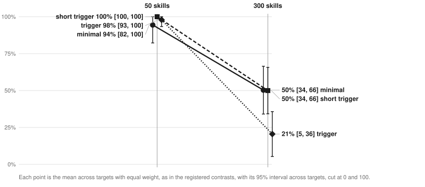

# because

If you write `CLAUDE.md` files or skills for Claude Code, this repo tells you which edits change what the agent does. It holds three preregistered randomized experiments, with the data, the checkers, and the harness to rerun every number.

In an exploratory comparison, which rule you write, and whether you write it at all, matters far more than how you word it. The registered test of a reason clause reads as inconclusive. Skill descriptions are where wording does matter, and past a fixed listing budget a long description never reaches the model.


Points are percentage points of compliance, or of skill loading in Studies 2 and 2b. Brackets are 95% intervals. Every result on this page is in [`results/NUMBERS.md`](results/NUMBERS.md), except the listing and audit figures, which link to their own reports.

You can see the rules, arms, and transcripts behind each number in the [explorer](https://abhaymettu.github.io/because/).

## What the studies found

### Which rule it is matters more than how it is worded

Compliance across the nine rules runs from 0.09 to 0.93. `final_no_digits` sits at the bottom and `write_tool` at the top. Having a rule adds +54.2 points [+33.1, +75.2] over having no rule. Both results are exploratory.

No wording factor survives Holm correction across the nine registered contrasts. Capitals come nearest, at +2.5 points [+0.2, +4.9], raw p 0.039, Holm p 0.353.

### The registered reading on reasons is inconclusive

A reason written for the rule, the "real" arm, is +0.2 points [-5.2, +5.7] against a filler sentence of matched length. A content-free placebo is +1.1 [-1.2, +3.5]. The registered bar for calling this a null was both upper bounds under 5 points. The real arm reached 5.7, so this result is not a null, and the code that applies the decision table prints `inconclusive`.

The data supports two narrower claims. There is no effect above about 6 points, and real and placebo are equivalent within 5 points (TOST p 0.040, a registered sensitivity check). Simulated power at 5 points is 0.56 with a slope SD of 3 points across rules and 0.34 with 6, so a smaller effect could easily go unseen.

This test is an analogue of Langer, Blank and Chanowitz (1978), the copier study, in which a placebic "because" worked for a small favor. That paradigm is contested, and Folkes (1985) reports studies that did not replicate it. The placebo effect does not reproduce here.

### With the description in view, a trigger list loads a skill more often

A trigger list ("Use when ...") beats one short sentence by +17.6 points [+6.3, +29.0], Holm p 0.023. The gain sits where the prompt does not use the skill's own words. Every wording loaded on every keyword prompt, and on generic prompts the gain is +46.7 [+3.9, +89.4] on 7 targets, a registered secondary with no correction.

"ALWAYS invoke" and a "Not for" clause both show +0.0, but both sat at a limit. Trigger lists already loaded at 1.00 in those cells, and decoy prompts loaded a skill at a rate of 0.007. A ceiling and a floor cannot show an effect, so this is no evidence of no effect.

### Past the listing budget, a long description never reaches the model

Claude Code 2.1.303 gives the skill listing a budget of 30,000 characters. We measured this with no model judgment, and a replay of the rule predicts all 4,915 listing entries we compared ([`docs/LISTING-MECHANISM.md`](docs/LISTING-MECHANISM.md)). Under the budget, every skill keeps its description. Past it, skills rank by past use on the account, ties go by name, and each skill keeps its description only if the description still fits. The environment variable `SLASH_COMMAND_TOOL_CHAR_BUDGET` changes the budget.

At 300 skills, an early name adds +51.3 points [+37.7, +64.8] over a late one. The long trigger list that wins below the budget loses past it. Study 2's registered test of that reversal was too wide to read, at -27.1 [-67.1, +13.0], so we preregistered Study 2b to settle it, with late names and no usage history. It holds within keyword, generic and indirect prompts alike (secondary).



| Wording | Example | Load rate, 50 skills | Load rate, 300 skills | Description reached the model, 300 skills |
|---|---|---|---|---|
| Short and plain | `Reconciles ledgers.` | 0.953 | 0.511 | 0.526 |
| Short trigger | `Use when reconciling ledgers.` | 1.000 | 0.500 | 0.338 |
| Long trigger list | `Use when reconciling a ledger or bookkeeping CSV against a bank statement, ...` | 0.978 | 0.211 | 0.000 |

At 300 skills, the short plain description beats the long list by +29.8 points [+19.2, +40.3], and the short trigger beats it by +29.4 [+20.5, +38.4]. At 50 skills, below the budget, the short trigger against the long list is +2.1 [-2.5, +6.7], so it has no measurable cost.

When the description is gone, the agent mostly does the job with no skill, in 0.72 of runs in Study 2b against 0.18 when the description is kept. It loads some other skill instead in only 0.02. This breakdown is exploratory.

### What to do with this

- Spend your effort on which rules you write and on whether a rule fits how the agent already works. This advice rests on the exploratory comparison above.
- Keep skill descriptions short. The short trigger form keeps the "when" and fits the budget.
- If your library is large, check what reaches the model. Past the budget, two accounts with the same library can see different listings, because the order depends on each account's usage.

## Check the numbers yourself

To check the harness, the checkers, and the analyses in under a minute, with no subscription, run:

```
make replay
```

This command takes about 40 s. It sends a stand-in agent through the real harness and compares the verdicts and estimates with the committed results.

To regenerate every number from the raw traces, also with no subscription, run:

```
make reproduce
```

`make rerun` repeats the runs themselves, and it needs Claude Code and a subscription. Study 1 averaged 9.3 turns and 33.5 s per run, and it cost $102.84 at API-equivalent prices.

## Point the harness at your own agent

`harness/agent_run.py` runs one agent in a clean room and captures every request. To test another agent, pass `command` and `read_stream` in `opts`:

```python
def my_command(prompt, model, effort, max_turns, tools):
    return ["my-agent", "--model", model, "--prompt", prompt]

def my_read_stream(stream):
    # Parse your agent's transcript from its stdout.
    return calls, commands, final_message, result_event

opts = {**opts, "command": my_command, "read_stream": my_read_stream}
```

`command` builds the command line, and `read_stream` reads the transcript. See `read_claude_stream` in the same file for the shapes to return. Everything downstream reads only the trace and the repo, so the checkers and the analyses work unchanged.

## How the studies are designed

**Split-plot randomization.** Study 1 has 1,000 runs and 7,072 focal observations. Each run is one `claude -p` on one task. Wording is drawn independently for each rule inside a file, and file length and user pressure are set per run. See [`PREREG.md`](PREREG.md).

**Filler as the comparator.** A reason clause adds length as well as meaning, so the primary comparator is a sentence of matched length with no reason, such as "This note is one of several notes kept here in this section." A placebo reads "because that is just how this particular part of the project is".

**Checkers instead of model judgment.** Code computes every verdict from the trace and the repo. No model scores an outcome. Naming the rule in the prompt gives 0.653 (n 72) and no rule gives 0.038 (n 1856), so this positive control shows that the assay can detect change. The registered test's false positive rate is 0.053 over 1000 simulations on the real assignment.

**Isolation proof.** `make isolation` sends one prompt twice, once isolated and once as a plain `claude -p`, and scans the outgoing requests for the operator's instruction files and skill names. See [`docs/ISOLATION.md`](docs/ISOLATION.md). A leak scan also runs on every request of every run, and a run that trips it is excluded and counted.

**Blind audit.** Before any contrast was computed, fresh model readers with no arm labels checked 100 focal observations against the checkers. Their job is to find checker faults, and they decide no outcome. They agreed on 92 of 100 with no qualification. The other eight all turn on one scope question: does a rule's "you write" reach throwaway code that never lands in the repo? We wrote that decision down before any contrast ([`docs/audit/report.md`](docs/audit/report.md)). An exploratory sensitivity scores `write_tool` on repo paths only. That changes 41 verdicts, with real at +0.0 [-5.3, +5.3] and placebo at +0.9 [-1.4, +3.1]. An earlier blind audit found one checker fault, which we fixed before rescoring every run.

**Frozen before the runs.** The git tags `prereg-study1`, `prereg-study2`, and `prereg-study2b` mark each preregistration, and `reading()` in the code applies each decision table. See [`PREREG-STUDY2.md`](PREREG-STUDY2.md) and [`PREREG-STUDY2B.md`](PREREG-STUDY2B.md).

## Limits

- All of this is one model, Sonnet 5.5, on one CLI version, 2.1.303. The listing rule can change with any release.
- We picked the nine rules off the ceiling in pilots, so the preregistered tests are claims about rules like these. That selection also brings some regression to the mean.
- The repos are synthetic, and we wrote the skill targets.
- The `aa-` and `zz-` prefixes are artificial. They force name order, so +51.3 is the size of the rule at an extreme, and a real library has mixed names and usage.
- Real reasons are plausible rationales that we wrote. The agent cannot check them.
- The "user in a hurry" factor also tells the agent to keep its work minimal, so it mixes behavior change with compliance. Net of unshown rules it is -2.7 [-13.9, +8.5].
- The worked example adds specification as well as form, and it has no length-matched control.
- Rules interact mechanically. Wrapping lines for `line_60` adds lines against `func_lines`, for example.
- Most shown rules carry a "because", more often than real files do, so a single clause may stand out less here.
- The blind audit can find a checker fault. It cannot show a small difference in checker error by arm.

## Deviations

Everything that changed after a freeze is in [`docs/DEVIATIONS.md`](docs/DEVIATIONS.md) with its date and reason. The registered analysis is still what we report.

The history was rewritten once, before the repo went public, to remove account and device identifiers from the sample captures. `git filter-repo` removed one `metadata` field from every kept capture, so commit and tag hashes changed. The preregistration files hash to the same git blobs at the new tags as at the old ones. The order of events still rests on commit dates and push history, which you cannot fully verify from outside, and we used no timestamping service.

Other deviations you should know about:

- A bug in the frozen analysis returned a NaN p-value when every rule agreed exactly, which corrupted Holm at a floor or ceiling. We fixed it after the first printout of Study 2.
- Study 2b stopped early on its registered quota stop, because Study 1 was running on the same account. 41 runs never ran, and the registration says to analyze whatever exists.
- One Study 2b run and two Study 2 runs are excluded by the leak scan. The Study 2b run is a false positive on a public skill's text.

## Prior work

A literature review on 2026-11-01 found no preregistered randomized test of a reason or placebo reason on a real coding agent ([`docs/REVIEW-1-novelty-design.md`](docs/REVIEW-1-novelty-design.md)). Absence after a search is not proof, and this field moves weekly. A [census of instruction files](https://www.alphaxiv.org/abs/2610.31715) says: "Whether reasons or emphasis change what agents do remains open."

Practitioner tests exist. An [Inferal blog post](https://inferal-com.pages.dev/blog/instruction-adherence-research) claims that a consequences strategy did not improve adherence, though it is informal and we could not verify its sample. [Scott Spence's sandboxed evals](https://scottspence.com/posts/measuring-claude-code-skill-activation-with-sandboxed-evals) measure skill activation and test hooks instead of description wording.

Position and file size repeat tests by [McMillan](https://www.alphaxiv.org/abs/2605.10039), who ran both on Claude Code and found nulls. Neither survives correction here. The effect of library size on skill loading belongs to [2610.18522](https://www.alphaxiv.org/abs/2610.18522). The new part here is randomizing the target skill's own description on real Claude Code, crossed with library size.

## Replication on Haiku

We also ran the Study 1 design on `claude-haiku-5-5`. We read it for sign only and claim nothing beyond the sign. Its rule pool was selected on Sonnet.

HAIKU_REPLICATION

## Credits and license

The distractor library in Studies 2 and 2b holds real skill names and descriptions from [`alirezarezvani/claude-skills`](https://github.com/alirezarezvani/claude-skills) (MIT), kept in `fixtures/distractors.json`.

This repo is under the [MIT license](LICENSE).
